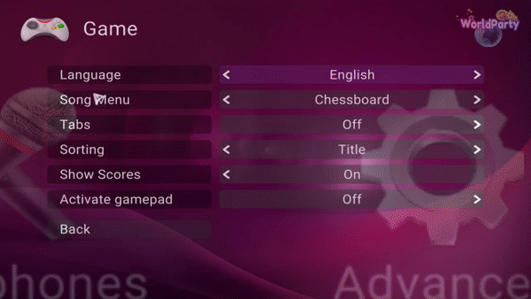

# UltraStar WorldParty

UltraStar WorldParty is a free and open source karaoke game.  It allows
up to six players to sing along with music using microphones in order to
score points, depending on the pitch of the voice and the rhythm of
singing.

UltraStar WorldParty is a fork of the original UltraStar Deluxe 1.1
We added new features such as new selection song, avatars, themes,
skins, font, improved camera and mouse support, thousands of new options
come with this new version. Check it out!

**Official Website:  https://ultrastar-es.org**

## Build

See the dists subfolders (depending on your dev environment) for detailed instructions on how to build UltraStar.

## Support and contact
Visit our [official website](https://ultrastar-es.org) where you can find tutorials, songs, contests and more

also visit our [forum](https://ultrastar-es.org/foro) where you can ask any problem or doubt you get (we speak mainly in Spanish and English)

## Screenshots

